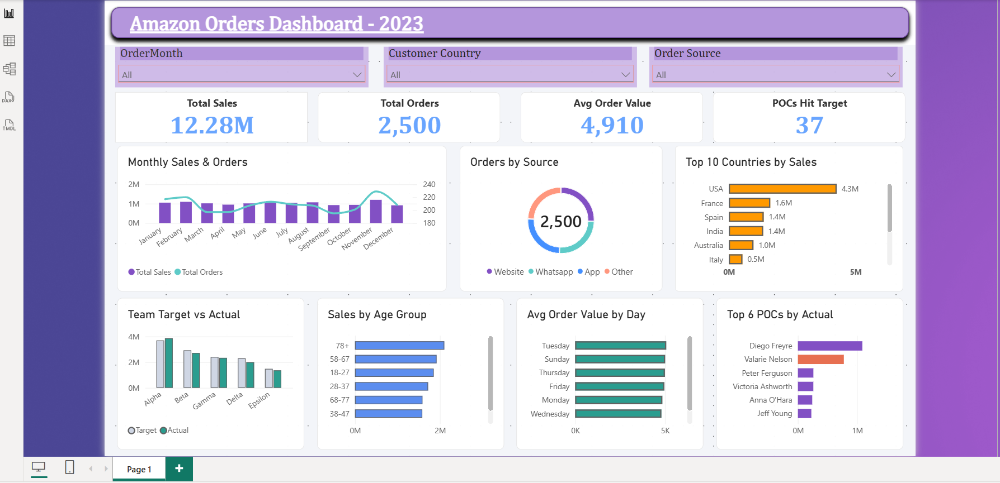
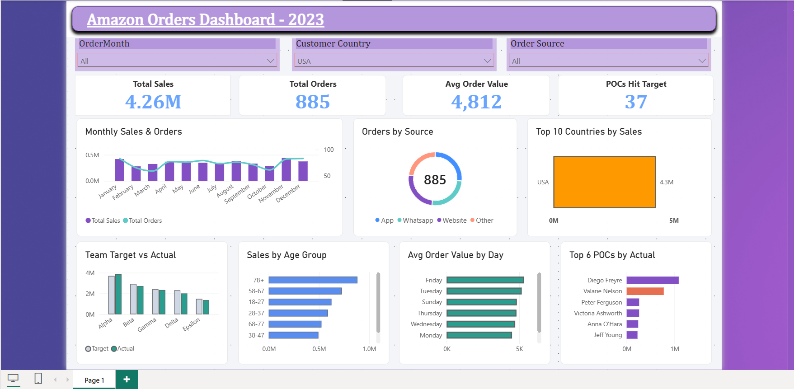
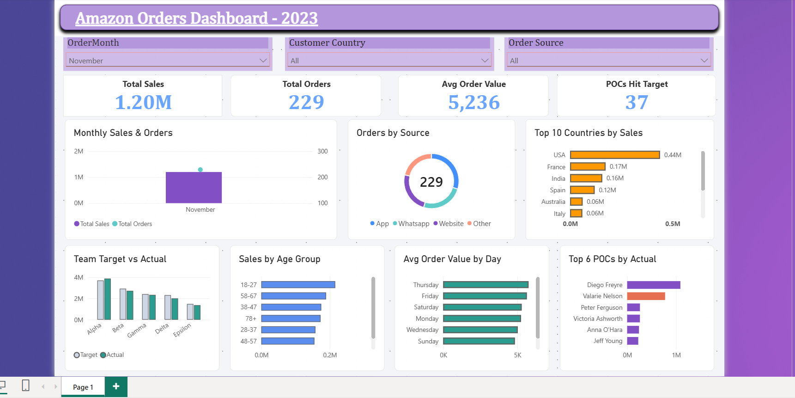
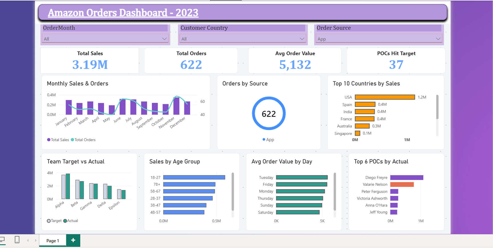

# Amazon Orders Dashboard - 2023

An interactive Power BI dashboard, backed by an Excel analysis, covering 2,500 customer orders from 2023. It tracks sales performance by month, country, order source, customer age group, weekday, and sales team against their yearly targets.









## Business questions answered
- How do sales and order volumes change month to month?
- Which countries and customer age groups drive the most revenue?
- Which order channels (Website, WhatsApp, App, Other) perform best?
- Which sales teams and sales POCs met their 2023 targets?

## Dataset
Three related tables, 2023 data:

| Table | Rows | Contents |
|---|---|---|
| Orders | 2,500 | Order ID, customer, country, date and time, order source, sales POC, order value |
| Customers | 2,500 | Customer ID, country, gender, age, category |
| Sales Targets | 92 | Sales POC, manager, team, 2023 target |

## Tools and skills
- **Microsoft Excel:** data cleaning (missing-value checks), lookups (`VLOOKUP`), `SUMIF`, `IF`, `TEXT`, outlier check with quartiles, pivot tables and charts
- **Power BI:** data modelling, KPI cards, slicers (Order Month, Customer Country, Order Source), interactive visuals, custom theme

## Dashboard contents
- **KPIs:** Total Sales (12.28M), Total Orders (2,500), Avg Order Value (4,910), POCs Hit Target (37)
- **Visuals:** Monthly Sales & Orders, Orders by Source, Top 10 Countries by Sales, Team Target vs Actual, Sales by Age Group, Avg Order Value by Day, Top 6 POCs by Actual

## Key insights
1. **The USA dominates:** it brings in about 4.26M, roughly 35% of total sales, and is more than 2.5x the next country (France, about 1.64M).
2. **November was the peak month** (about 1.20M); **December was the weakest** (about 0.92M).
3. **Order sources are balanced:** Website (637), WhatsApp (633), App (622) and Other (608) are within about 5% of each other, so no single channel is a dependency.
4. **Targets were narrowly missed overall:** actual sales were about 12.28M against a combined team target of about 12.81M (around 96%). Only the **Alpha** team exceeded its target (3.86M vs 3.69M).
5. **Only 37 of 92 sales POCs (about 40%) hit their target.** Diego Freyre was the top performer at about 1.09M (roughly 109% of target).
6. **Age matters:** the 78+ group generated the most sales (about 2.10M), followed by 58–67 (about 1.92M) and 18–27 (about 1.85M).
7. **Average order value is stable across weekdays** (about 4,670 to 5,070), so revenue depends more on order count than on basket size.

## Data quality notes
- 7 orders have a missing customer country.
- Currency isn't specified in the source data, so values are shown as plain numbers.

## Repository structure
```
├── data/        Excel workbook with raw data, pivots and charts
├── powerbi/     .pbix dashboard file
├── images/      dashboard screenshots
├── report/      PDF export of the dashboard
└── README.md
```

## How to use
1. Download the `.pbix` file from `/powerbi` and open it in Power BI Desktop.
2. Use the slicers at the top to filter by month, country or order source.
3. Open the Excel file in `/data` to see the pivot tables and the supporting analysis.
4. No Power BI? Open the PDF in `/report` to see the dashboard.

## Author
**Abhayjit Verma** | [LinkedIn](https://www.linkedin.com/in/abhayjit-verma) | [GitHub](https://github.com/abhay-verma007)
